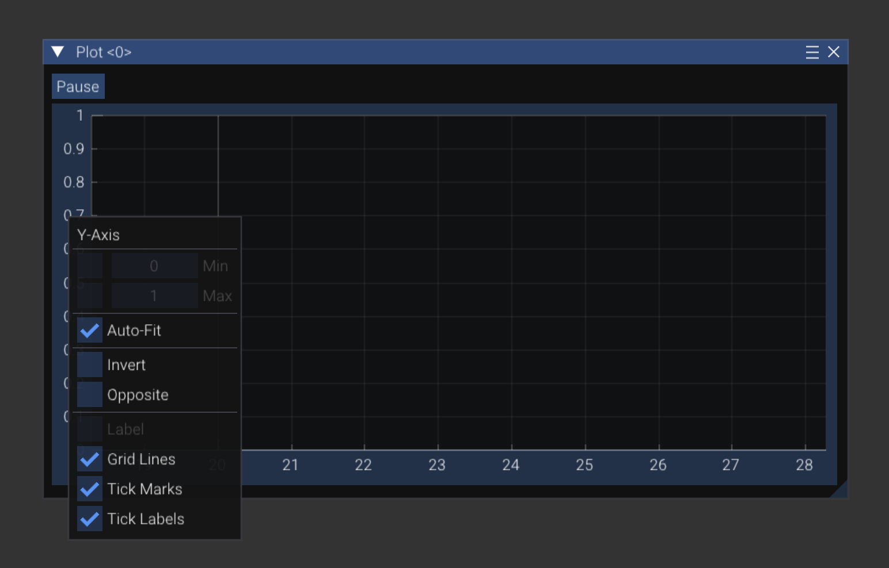

# Glass and power-draw tests

**Glass** is a WPILib tool that shows the values your robot code
publishes, live, and graphs them. In this chapter you'll learn to use it,
then run your first **power-draw test**: slow a motor down with a rag,
and watch what the currents do. Later in Part 2, you'll use the same
skills on the real robots.

You need:

* the Kraken code from [Control a motor from code](../part1/08_MOTOR_CODE.md),
  deployed and working
* a laptop connected to the RoboRIO (USB-B is fine)

<!--
PHOTO CHECKLIST: save these in docs/img/ and replace each "TODO" note below.
  [ ] glass_start_tool.png        VS Code "WPILib: Start Tool" list with Glass
  [ ] glass_nt_settings.png       Glass NetworkTables Settings, client mode
  [ ] glass_log_tree.png          NetworkTables tree open at log/motor/KrakenX60Motor
  [ ] glass_plot_current.png      plot of supply and stator current while the motor runs
  [ ] glass_rag_test.png          annotated rag-test graph (zero, soft, hard)
-->

## Where the numbers come from

Our loggers (`LoggerFactory`) publish values to **NetworkTables**, a
shared list of named values that the robot and your laptop both see.
Glass is a window onto NetworkTables.

Every Kraken already logs these, among others:

| Name | Meaning |
| --- | --- |
| `velocity (rad_s)` | How fast it's turning |
| `output [-1,1]` | Duty cycle it's actually applying |
| `supply current (A)` | Current pulled **from the battery** |
| `stator current (A)` | Current going **through the motor windings** |
| `supply voltage (V)` | Battery voltage, as the motor sees it |
| `temperature (C)` | How hot the motor is |

And the robot as a whole logs:

| Name | Meaning |
| --- | --- |
| `log/Robot/voltage` | Battery voltage |
| `log/Robot/TotalCurrentLog/total supply current (A)` | Supply current of every motor, added up |

> **Supply vs. stator current.** When a motor is spinning slowly but
> pushing hard (like a stalled arm), the motor controller turns 12 V
> from the battery into a lower voltage at a higher current. So stator
> current can be **much bigger** than supply current. Stator current
> makes heat and torque. Supply current drains the battery and trips
> breakers. That's why
> [`CurrentLimit`](https://github.com/Team100/all26/blob/main/lib/src/main/java/org/team100/lib/config/CurrentLimit.java)
> has a limit for each. The full story is in
> [How motors work](../part1/06_HOW_MOTORS_WORK.md#stator-current-vs-supply-current).

## Open Glass and connect

1. Start Glass.
   * **Windows:** in VS Code, `Ctrl+Shift+P` → **WPILib: Start Tool** →
     **Glass**.

     > 📷 **TODO screenshot:** `docs/img/glass_start_tool.png`.
   * **Mac:** Glass isn't in VS Code's **Start Tool** list. Don't use
     Spotlight either: every WPILib year installs its own Glass, all
     called "Glass", and Spotlight may open the wrong year's. Open the
     right one by its folder instead:
     1. In Finder, **Go → Go to Folder…** (`Shift+Cmd+G`), and type
        `~/wpilib/2026/tools`. (`2026` is the WPILib year; for the
        SystemCore, from Part 4 on, it's `2027`.)
     1. Double-click **Glass**. If the Mac says it can't be opened,
        right-click it → **Open** → **Open**.

     Or, in Terminal: `open ~/wpilib/2026/tools/Glass.app`

     Tip: once it's running, right-click its Dock icon → **Options** →
     **Keep in Dock**, so next time you get the same one.

     > **TODO (mentors):** check the `2027` folder name on a Mac with
     > 2027 WPILib installed.

1. Connect Glass to the robot:
   1. **NetworkTables Settings** → **Client**
   1. **Team** → **100** (our team number)
   1. **Apply**

   Glass works out the robot's address for you, whether you're on USB or
   the robot network.
   * For the [simulator](../part1/09_SIMULATOR.md), type `localhost` instead of 100.
   * Still not connecting? Type the robot's address instead: `10.1.0.2`
     on the robot network, or `172.22.11.2` over USB.

   > 📷 **TODO screenshot:** `docs/img/glass_nt_settings.png`: Client
   > mode with 100 in Team.

1. The title bar should say it's connected.
   > **TODO:** check the exact wording Glass shows when it's connected.

## Find your motor's values

> [!IMPORTANT]
> ## ‼️ Don't see any logs?
>
> **Go back and make sure you
> [set up logging correctly](../part1/08_MOTOR_CODE.md#step-2-keep-the-library-ticking)
> in your `robotPeriodic()`.** If it doesn't call `LogPoller.log()`
> (and `Takt.update()`, `Cache.refresh()`, and
> `CommandScheduler.getInstance().run()`) every cycle, **nothing** shows
> up under `log`, no matter what you do in Glass. Your code still builds,
> deploys, and spins the motor, so this is easy to miss.
>
> Then go down this list, in order:
>
> 1. **Is Glass connected?** The title bar says so; if not, see
>    [above](#open-glass-and-connect).
> 1. **Is your code running?** **Robot Code** is green in the Driver
>    Station.
> 1. **Is it *your* code?** Did the deploy say `BUILD SUCCESSFUL`, after
>    your last change?
> 1. **Did you create the motor with a logger?** The first argument is
>    `log.name("motor")`, where `log` came from `Logging.root()`.
> 1. **Is the log level right?** See below: `DEBUG` or `TRACE`, not
>    `COMP`.
>
> Still stuck? Show a mentor your `robotPeriodic()` first.

1. Open **NetworkTables → NetworkTables View**.
1. Open `log`, then `motor` (the name you gave in `log.name("motor")`),
   then `KrakenX60Motor`.

   > 📷 **TODO screenshot:** `docs/img/glass_log_tree.png`.

See `log`, but not `supply current (A)`? The robot only publishes
values at or above the **log level**. Open `SmartDashboard` → `Log Level` and make
sure it's `DEBUG` (the default) or `TRACE`, not `COMP`.

> 📷 **TODO screenshot:** retake the log level picture above in Glass on
> on the robot, with `DEBUG` selected.

**Checkpoint:** enable teleop, push the stick, and watch `velocity
(rad_s)` change.

## Make a graph

1. **Plot → New Plot Window**.
1. Drag `supply current (A)` and `stator current (A)` from the
   NetworkTables view onto the plot. Add `log/Robot/voltage` too.
1. Turn on **Auto-Fit**: right-click the numbers along the plot's left
   edge, then check **Auto-Fit**. Do this for every new plot.

   
1. Run the motor at a few speeds with the stick.

> **Why Auto-Fit?** A new plot's up-and-down axis (the **Y axis**) only
> goes from 0 to 1. Anything outside that range is off the screen, so a
> 12 V battery line or a **negative** number seems to be missing. (Speed
> and output go negative when the motor runs backwards.) Auto-Fit keeps
> resizing the axis so your lines fit, above and below zero.
>
> Want to fit it just once? Double-click the plot.

> 📷 **TODO screenshot:** `docs/img/glass_plot_current.png`: supply
> and stator current while the motor runs.

Glass is also where you **choose which auton runs** on a real robot
(**SmartDashboard** → **Auton Command**), because the Driver Station
can't.
See [Work on auton](../part3/14_AUTON.md#part-6-run-it-on-a-real-robot).

The WPILib [Glass docs](https://docs.wpilib.org/en/stable/docs/software/dashboards/glass/index.html)
cover more widgets, like the field view you used in the simulator.

## Your first power-draw test: the rag test

Time to see stator and supply current with your own eyes. You'll slow
the motor down with your hand (through a rag), and watch what the graph
does.

> [!WARNING]
> **Use a rag, never bare fingers**, and keep it low and slow:
> * the test board motor, at **10% or less**
> * your **10 A** current limit from
>   [Control a motor from code](../part1/08_MOTOR_CODE.md) (don't raise it)
> * a mentor watching, and one person's finger on **Enter** (disable)
>
> Wrap the rag around the **shaft** (or the wheel or hub on it) and
> squeeze. If anything grabs or pulls the rag, let go and disable.

1. Graph `velocity (rad_s)`, `stator current (A)`, `supply current (A)`,
   and `log/Robot/voltage`.
1. Run the motor at a steady **10%** with the stick.
1. Then, about **5 seconds** each:
   1. **Zero:** don't touch it.
   1. **Soft:** squeeze the shaft gently through the rag, so it slows a
      little.
   1. **Hard:** squeeze hard, until it almost stops.
   1. **Zero** again: let go.
1. Take a screenshot of the graph right away.

> 📷 **TODO screenshot:** `docs/img/glass_rag_test.png`: an annotated
> rag-test graph (zero, soft, hard).

**Annotate your screenshot:** mark on it where you were pinching
**zero**, **soft**, and **hard**. (Your phone's photo editor, or any
drawing tool, is fine.) Then post it to **`#rookie_training`** in Slack.

> **Check yourself:**
> 1. When you squeezed **hard**, which current went up more: stator or
>    supply? Why? (See
>    [How motors work](../part1/06_HOW_MOTORS_WORK.md#stator-current-vs-supply-current).)
> 2. Did the stator current flatten out at about 10 A when you squeezed
>    hard? What was doing that?
> 3. What did the speed do? And the battery voltage?

**Checkpoint:** your annotated graph is in `#rookie_training`, and you
can answer the three questions.

**We'll use this later to measure our real robots**: the
[Discus](11_DISCUS.md) and the [shooter bot](12_DEMO_BOT.md).

Next: [Easy mode: the Discus](11_DISCUS.md)
